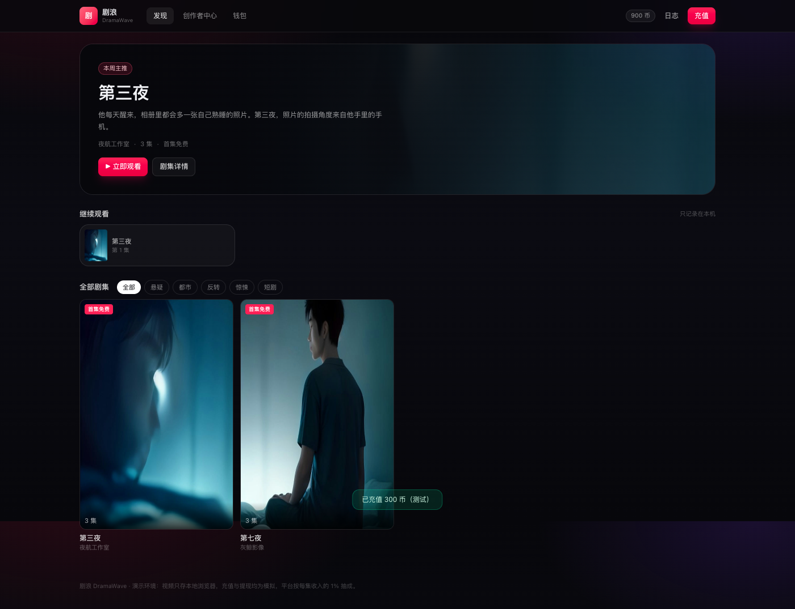
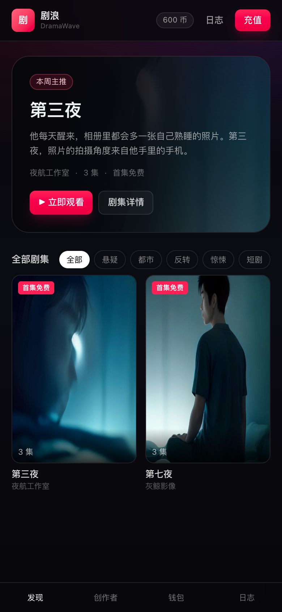
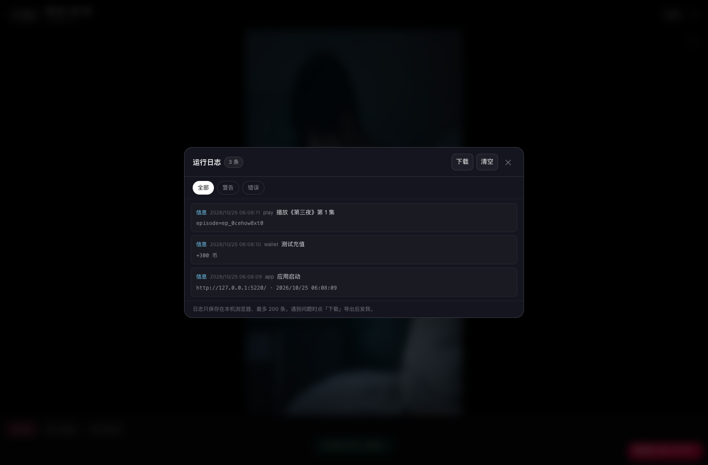
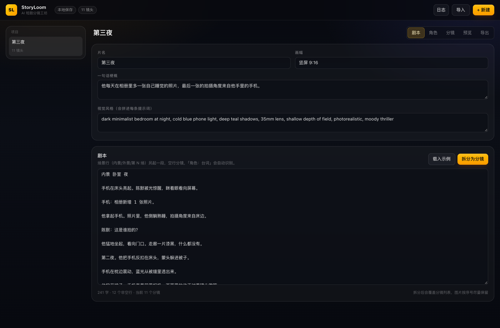

# 剧浪 DramaWave · 竖屏短剧平台（MVP）

DramaBox 式竖屏短剧平台的可运行原型：创作者发布剧集，观众按集解锁，平台按**每集收入的 1%**抽成。附带 AI 分镜工坊 StoryLoom，可从剧本一路做到预览、导出，并把项目直接导入剧浪合成视频。

DramaBox-style vertical short-drama platform MVP. Creators publish episodes, viewers unlock per episode, the platform keeps 1% of each episode's revenue. Includes StoryLoom, a browser-based AI storyboard studio.

> 纯前端演示：没有服务器、账号或真实支付，数据只存在当前浏览器。



## 仓库结构

```
apps/
  dramawave/   剧浪平台（React 19 + TS + Tailwind 4 + Vite）
  storyloom/   AI 短剧分镜工坊（剧本 → 分镜 → 出图 → 导出）
docs/          截图
```

每个应用都有独立 README：

- [剧浪 DramaWave](apps/dramawave/README.md)
- [StoryLoom](apps/storyloom/README.md)

## 本地运行

需要 Node.js 20+。两个终端分别启动：

```bash
cd apps/dramawave
npm install --include=dev
npm run dev        # http://127.0.0.1:5220
```

```bash
cd apps/storyloom
npm install --include=dev
npm run dev        # http://127.0.0.1:5210
```

生产构建：`npm run build`，产物在各自 `dist/`。

## 核心流程

1. StoryLoom 写剧本、拆分镜、生成图片
2. 「导出」页点「发布到剧浪」，下载项目 JSON
3. 剧浪 → 创作者中心 → 从 StoryLoom 导入 → 设价格 → 合成并发布
4. 观众解锁，写入账单，按每集 1% 分账

合成在浏览器内完成：Canvas 1080 竖屏画布（输出 720×1280、24fps）+ `captureStream` + `MediaRecorder`，实时录制 VP9 WebM，带 Ken Burns 推镜、转场和烧录字幕。

## 分账规则

- 1 币 = ¥0.10
- 每集独立结算：`平台 = round(该集收入 × 1%)`，其余归创作者
- 例：30 币（¥3.00）→ 平台 ¥0.03，创作者 ¥2.97
- 免费集不产生分账；提现是本地演示账单，不会真实打款

## 已实现

**观众端**：发现页 / 标签筛选 / 继续观看、剧集详情、全屏竖屏播放、解锁扣币、钱包与账单、播放结束重播。

**创作端**：新建剧集、上传本地视频（IndexedDB，≤200MB）、单集上下架、删除、StoryLoom 导入与浏览器内合成、数据看板、提现申请（模拟）。

**运行日志**：顶部「日志」查看、筛选和下载运行日志；自动记录启动、播放、解锁、导入、合成、上传、存储失败和未捕获异常，最多保留 200 条在本机。

**数据**：剧集/钱包/账单在 `localStorage`；视频二进制在 IndexedDB；封面压到 720px 宽。

## 上线还缺什么

账号与创作者认证、对象存储 + 转码 + CDN、真实支付与退款对账、结算与提现审核、内容审核与版权投诉、签名播放地址 / DRM。详见 [剧浪 README](apps/dramawave/README.md)。

## 已知限制

- 视频只存在当前浏览器，换设备或清缓存会丢
- 合成结果是 VP9 WebM，个别 Safari 版本可能无法播放
- 充值、提现、分账均为本地模拟
- 1% 抽成按分四舍五入，小额订单会向上取整（如 ¥2.50 → ¥0.03）
- StoryLoom 出图使用公开的 Pollinations 接口，需要联网

## 技术栈

React 19 · TypeScript · Vite 6 · Tailwind CSS 4 · 浏览器 Canvas / MediaRecorder / IndexedDB · Playwright（开发期回归）






